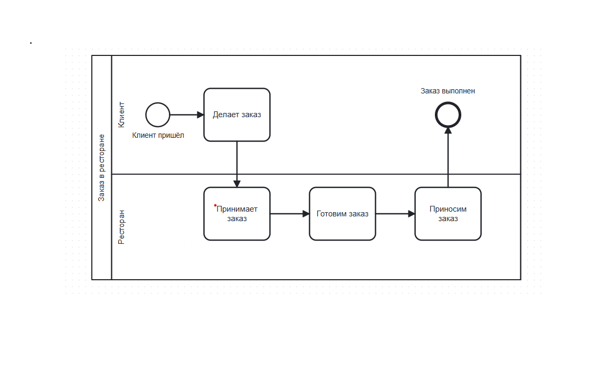

# Портфолио системного аналитика

Привет! Меня зовут Диляра. Я изучаю бизнес-информатику в КФУ и развиваюсь в системном анализе.

## 🚀 Проект 1: Моделирование бизнес-процесса «Заказ в ресторане»

* **Инструмент:** bpmn.io
* **Нотация:** BPMN 2.0

### 🖼️ Визуализация схемы:

### 📋 User Stories:
* **US 1:** Как Клиент, я хочу оставить чаевые, чтобы отблагодарить персонал.
* **US 2:** Как Повар, я хочу менять статус заказа на «Готово» в системе, чтобы официант видел, что блюдо можно забирать.
* **US 3:** Как Официант, я хочу вносить заказ в мобильное приложение, чтобы он мгновенно появлялся на экране у поваров.
