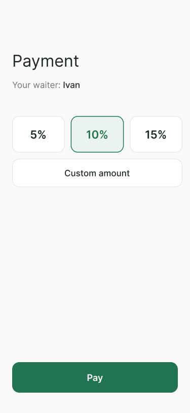

# Спецификация требований: Функция «Оплата счета с чаевыми»

## 1. Бизнес-цель
Увеличить выручку ресторана и повысить мотивацию официантов за счет прозрачной системы чаевых.

## 2. Функциональные требования
* На экране оплаты должна быть кнопка «Оставить чаевые».
* При нажатии должны быть доступны варианты: 5%, 10%, 15% и кнопка «Своя сумма».
* Если выбрана «Своя сумма», открывается поле для ввода цифр.
* На экране оплаты должно отображаться имя официанта.
* В чеке итоговая сумма должна отображаться отдельно: Сумма счета + Чаевые = Итого.
* После успешной оплаты клиенту должен высвечиваться выбор оценки обслуживания от 1 до 5.

## 3. Нефункциональные требования
* Перевод чаевых не должен занимать больше 3 секунд.
* Если интернет пропал, приложение должно показать ошибку «Нет соединения» и не списывать деньги.
## 4. Макет экрана (Прототип)

